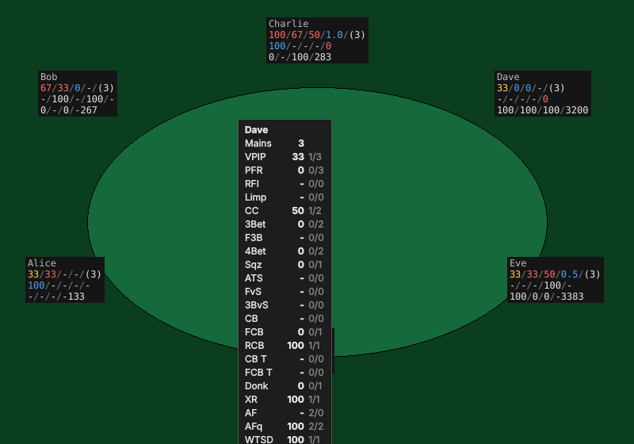

# Fleur — HUD de poker pour Winamax

Fleur affiche les statistiques de tes adversaires directement sur les tables
Winamax, comme PokerTracker 4. Il lit les **historiques de mains** que le client
Winamax écrit sur ton disque : aucune lecture d'écran, aucune interaction avec le
logiciel Winamax.



## Installation (Windows)

1. Installer [Python 3.11+](https://www.python.org/downloads/) (cocher *Add python.exe to PATH*).
2. Dans le dossier du projet :
   ```bat
   pip install -r requirements.txt
   ```
3. Dans les options du client Winamax, vérifier que l'enregistrement de
   l'historique des mains sur le disque est activé.

## Utilisation

```bat
python -m fleur              :: importe l'historique existant puis lance le HUD
python -m fleur import       :: importe seulement
python -m fleur stats        :: joueurs les plus rencontrés
python -m fleur stats Pseudo :: toutes les stats d'un joueur
python -m fleur stats --list :: liste des stats disponibles
python -m fleur config       :: emplacements de la config, de la base, des historiques
python -m fleur windows      :: titres des fenêtres ouvertes (diagnostic)
python -m fleur diagnostic   :: crée un rapport zip sur le bureau
```

Ou double-cliquer sur `lancer_hud.bat` (avec console) ou
`lancer_hud_silencieux.bat` (sans console, tout passe par l'icône).

### Icône dans la barre des tâches

Une fleur rose apparaît près de l'horloge. Clic droit :

- état (tables suivies, mains de la session, problèmes de lecture) ;
- **Masquer / Afficher le HUD** (ou double-clic sur l'icône) ;
- **Recharger la configuration** après avoir modifié `config.json` ;
- **Réinitialiser la position des panneaux** ;
- ouvrir le dossier de configuration ou celui des historiques ;
- **Créer un rapport de diagnostic** ;
- quitter.

### Diagnostic

Fleur contrôle chaque main lue : lignes non reconnues, joueurs inconnus, et
surtout **cohérence des gains** (la somme des gains et pertes doit égaler le
rake, et le pot recalculé doit égaler le « Total pot » de Winamax). Tout écart
est consigné dans `%APPDATA%\Fleur\diagnostic\` avec la main concernée, ainsi
que les titres de fenêtres vus quand une table est introuvable. Une
notification prévient en cas de problème.

Le rapport (`fleur_diagnostic_<date>.zip`, sur le bureau) contient le journal,
ces fichiers, la configuration et la liste des fenêtres ouvertes. Les mains
mal lues qu'il contient incluent les pseudos de la table.

Le dossier d'historiques est détecté automatiquement
(`%APPDATA%\winamax\documents\accounts\<pseudo>\history` pour le client actuel,
`Documents\Winamax Poker\accounts\<pseudo>\history` pour les anciens). Sinon :
`python -m fleur --history "C:\chemin\vers\history"`.

Seules les mains de cash game (tables classiques et ESCAPE) sont importées.
Les mains de tournoi (jetons) sont ignorées sauf si `include_tournaments`
vaut `true` dans la configuration.

### Sur la table

- Un panneau par adversaire, qui suit la fenêtre de la table et se met à jour à chaque main.
- **Glisser** un panneau pour le déplacer : la position est mémorisée pour toutes
  les tables du même format (6-max, 9-max…).
- **Double-clic** : popup avec toutes les stats et les échantillons (ex. `3/12`).
- Les couleurs s'activent à partir de 30 mains (réglable).

### Panneau par défaut

```
Pseudo
VPIP / PFR / 3Bet / AF / (mains)
F3B  / ATS / FvS  / CB / FCB
WTSD / W$SD / WWSF / BB/100
```

## Stats disponibles

| Clé | Stat | Clé | Stat |
|---|---|---|---|
| `vpip` | VPIP | `cbet` | C-bet flop |
| `pfr` | PFR | `fcbet` | Fold au c-bet flop |
| `3bet` | 3-bet | `rcbet` | Relance du c-bet flop |
| `f3bet` | Fold au 3-bet | `cbet_t` / `fcbet_t` | C-bet / fold c-bet turn |
| `4bet` | 4-bet | `donk` | Donk bet flop |
| `rfi` | Raise first in | `xr` | Check-raise flop |
| `limp` | Limp | `af` / `afq` | Agression (facteur / fréquence) |
| `cc` | Cold call | `wtsd` | Went to showdown |
| `sqz` | Squeeze | `wsd` | W$SD |
| `steal` | Attempt to steal | `wwsf` | Won when saw flop |
| `fsteal` | Fold vs steal (blindes) | `bb100` | BB/100 |
| `3bsteal` | 3-bet vs steal | `hands` / `net` | Mains / gains |

## Configuration

`%APPDATA%\Fleur\config.json` (créé au premier lancement) :

- `hud_lines` : les stats de chaque ligne du panneau ;
- `popup_stats` : les stats du popup ;
- `colors` : seuils de couleur par stat ;
- `show_hero` : afficher son propre panneau ;
- `hero_at_bottom` : le héros est en bas de la table (réglage par défaut de Winamax) ;
- `font_size`, `opacity`, `min_hands_for_colors`, `history_dirs`.

Les positions des panneaux sont dans `%APPDATA%\Fleur\layouts.json`.

## Exécutable

```bat
pip install -r requirements-dev.txt
build_exe.bat
```

## Tests

```bash
pip install -r requirements-dev.txt
python -m pytest
```

## Règlement Winamax

Un HUD alimenté par ses propres historiques est en principe autorisé chez Winamax,
contrairement aux outils d'aide à la décision en temps réel (solveurs, conseils).
Vérifie les conditions générales en vigueur avant de jouer en argent réel.
